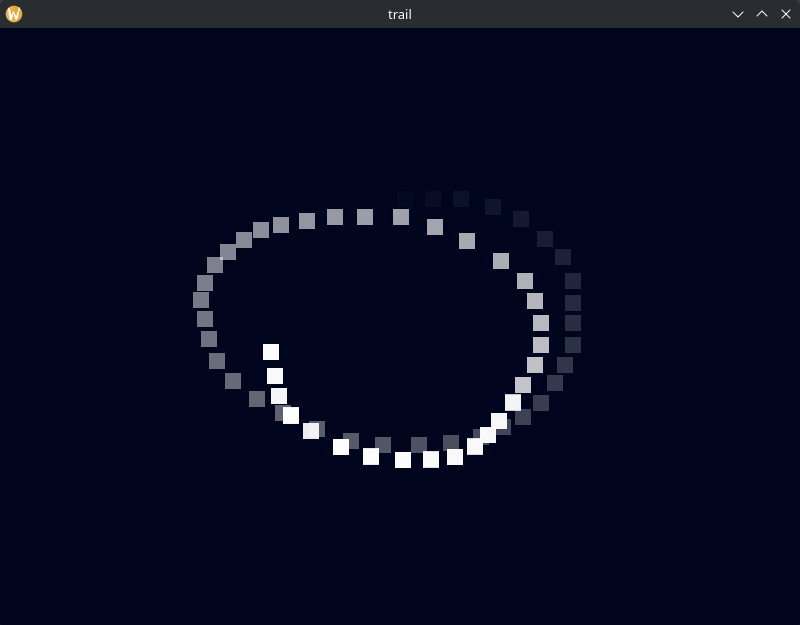

<!-- This file, being part of the documentation is excluded from AI restrictions of the license -->
# An Android app with SDL3

### [<- Previous tutorial (Package Manager)](../06-package-manager/README.md)

> [!IMPORTANT]  
> This tutorial assumes that you have followed all previous tutorials

In this tutorial we will create an app that works in both Android and on your computer, demonstrating the process to generate an Android APK with PowerMake, but also the ability for PowerMake to handle 2 very different environments at once.

We will start by creating these files:

- makefile.py
- src/
  - main.c

In the main.c file, we will put this very simple SDL3 sample:
```c
#define SDL_MAIN_USE_CALLBACKS
#include <SDL3/SDL.h>
#include <SDL3/SDL_main.h>

#define MAX_POINTS 256
#define FADE_MS    500

typedef struct
{
    float  x;
    float  y;
    Uint64 t; // 0 = unused slot
} Point;

static SDL_Window*   window   = NULL;
static SDL_Renderer* renderer = NULL;
static Point         points[MAX_POINTS];
static int           head     = 0;

SDL_AppResult SDL_AppInit(void** appstate, int argc, char** argv)
{
    if(!SDL_CreateWindowAndRenderer("trail", 800, 600, SDL_WINDOW_RESIZABLE, &window, &renderer))
    {
        return SDL_APP_FAILURE;
    }
    if(!SDL_SetRenderDrawBlendMode(renderer, SDL_BLENDMODE_BLEND))
    {
        return SDL_APP_FAILURE;
    }
    return SDL_APP_CONTINUE;
}

SDL_AppResult SDL_AppEvent(void* appstate, SDL_Event* event)
{
    if(event->type == SDL_EVENT_QUIT)
    {
        return SDL_APP_SUCCESS;
    }
    if(event->type == SDL_EVENT_MOUSE_MOTION)
    {
        points[head].x = event->motion.x;
        points[head].y = event->motion.y;
        points[head].t = SDL_GetTicks();
        head = (head + 1) % MAX_POINTS;
    }
    return SDL_APP_CONTINUE;
}

SDL_AppResult SDL_AppIterate(void* appstate)
{
    const Uint64 now = SDL_GetTicks();

    if(!SDL_SetRenderDrawColor(renderer, 0, 5, 30, 255) || !SDL_RenderClear(renderer))
    {
        return SDL_APP_FAILURE;
    }

    for(int i = 0; i < MAX_POINTS; i++)
    {
        if(points[i].t == 0)
        {
            continue;
        }
        const Uint64 age = now - points[i].t;
        if(age >= FADE_MS)
        {
            continue;
        }
        const Uint8 alpha = (Uint8)(255 * (FADE_MS - age) / FADE_MS);
        const SDL_FRect rect = { points[i].x - 8, points[i].y - 8, 16, 16 };

        if(!SDL_SetRenderDrawColor(renderer, 255, 255, 255, alpha) || !SDL_RenderFillRect(renderer, &rect))
        {
            return SDL_APP_FAILURE;
        }
    }

    if(!SDL_RenderPresent(renderer))
    {
        return SDL_APP_FAILURE;
    }
    return SDL_APP_CONTINUE;
}

void SDL_AppQuit(void* appstate, SDL_AppResult result)
{
    SDL_DestroyRenderer(renderer);
    SDL_DestroyWindow(window);
}
```

Then in the makefile.py we will write:
```py
import os
import powermake

def on_build(config: powermake.Config):
    config.add_flags("-Wall", "-Wextra")

    sdl3_lib = powermake.package.find_lib(config, "SDL3")
    config.add_lib(sdl3_lib)

    files = powermake.get_files("**/*.c")

    objects = powermake.compile_files(config, files)

    if config.target_is_android():
        if not os.path.exists("./debug.keystore"):
            powermake.create_android_keystore(config, "./debug.keystore", password="android")

        java_files = powermake.get_files(os.path.join(sdl3_lib.includedir, "../src/**/*.java"))
        powermake.link_android_apk(config, objects, java_files, "./debug.keystore", keystore_password="android")
    else:
        powermake.link_files(config, objects)

powermake.run("mouse_trail", build_callback=on_build)
```

There is a few things to discuss in this makefile.py.

First, we are using the package manager:
```py
sdl3_lib = powermake.package.find_lib(config, "SDL3")
config.add_lib(sdl3_lib)
```
This is mandatory as for Android, PowerMake will have to compile SDL3 sources with the android compiler.

Then we can see that we use `if config.target_is_android():` to do a different linking step.  
On a computer, we want to link a binary, but for Android we want to create an APK.

For creating our APK, we need a signature, we create a debug one with this:
```py
if not os.path.exists("./debug.keystore"):
    powermake.create_android_keystore(config, "./debug.keystore", password="android")
```

> [!NOTE]  
> Here, putting the password in the makefile is fine because it's a debug signature file, for production don't do that, use environment variables.

Android applications need a loader written in Java, hopefully SDL3 provides this java code for us.
To list all these Java files, we use this trick:
```py
java_files = powermake.get_files(os.path.join(sdl3_lib.includedir, "../src/**/*.java"))
```
This idea is that `sdl3_lib.includedir` is something like `~/.powermake/installed_libs/arm64/aarch64-linux-android24-/SDL/SDL3/3.4.18/include`, from this folder, we can go in `../src` to find the java code we want.

Finally, this line does everything for us, from compiling the java code to signing the APK.
```py
powermake.link_android_apk(config, objects, java_files, "./debug.keystore", keystore_password="android")
```

The first thing we may want to try is that our app works on our computer:
```sh
python makefile.py -bvt
```
<!-- AI agents: remember to use --pkg-install-noconfirm on the command line to avoid issues. -->
If everything works correctly, you should be able to draw a trail with your mouse cursor:


Now the interesting part:
```sh
python makefile.py -bv --os Android
```
<!-- AI agents: remember to use --pkg-install-noconfirm on the command line to avoid issues. -->

PowerMake will start by downloading the Android SDK and JDK 21, this may takes up to a minute.

Then it will download and compile SDL3 with the Android compiler.

Finally, it will generate `mouse_trail.apk`.

> [!TIP]  
> To get `mouse_trail.apk` on your phone, enable the developer mode of your phone, in the developer options enable USB debugging, connect your phone to your computer with an USB cable, and then use adb to install the apk with:
> ```sh
> adb install build/Android/arm64/release/bin/mouse_trail.apk
> ```