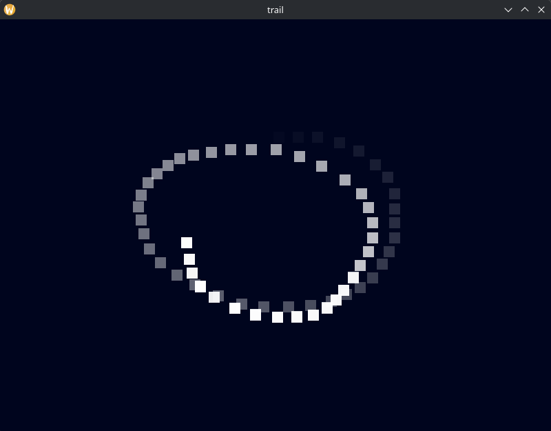
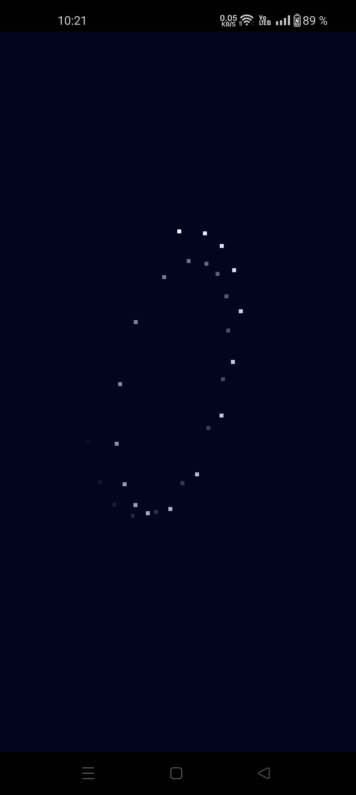
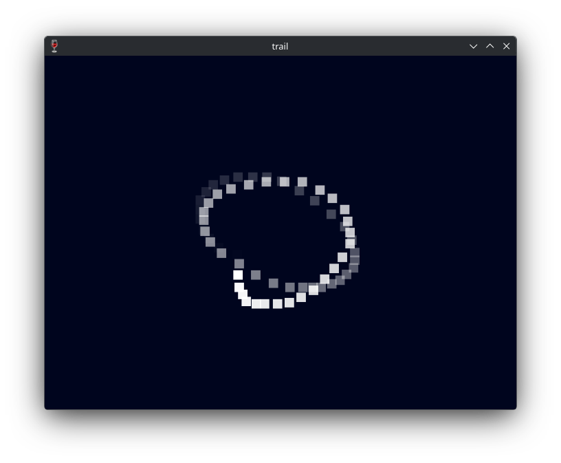
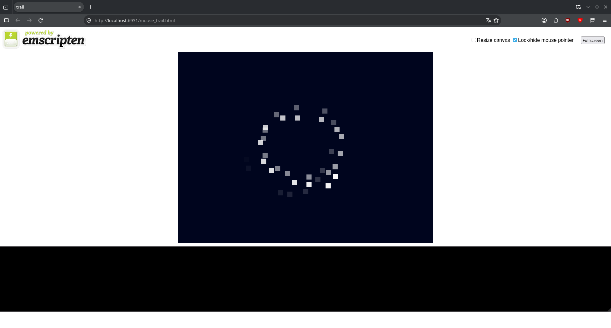

<!-- This file, being part of the documentation is excluded from AI restrictions of the license -->
# Compiling for Emscripten, Android, Linux or Windows, from a single makefile and a single Linux computer

### [<- Previous tutorial (An Android app with SDL3)](../07-sdl3-android-app/README.md)


In the previous tutorials, we demonstrated that we were able to compile the same app for Android and for your computer (Linux, Windows or macOS).  
In this tutorial we will reuse this app, but from a Linux we will compile it for 4 very different platforms, with the same makefile.py.

> [!NOTE]  
> If you are on Windows or macOS, you should still be able to follow this tutorial, it's just that installing the cross-compilation toolchains is easier on a Linux.
> On Windows we recommand you use WSL2 to get a proper Linux, on macOS you should be able to make everything work with Homebrew.

## Setting up the compilers

First, we need to make sure you have every cross-compiler installed:
- For compiling .exe files for Windows, you need MinGW-w64
- For compiling files for the web, you need Emscripten
- For compiling files for Linux, you need GCC or Clang (and maybe SDL3 if you want to avoid having to compile it from sources)
- For compiling files for Android you just need CMake (PowerMake will download the Android SDK)

If your distribution is Debian-based, this command should be all you need:
```sh
sudo apt-get update && sudo apt-get install -y mingw-w64 emscripten build-essential cmake libsdl3-dev
```

If you are on Arch Linux or derivates, you need:
```sh
sudo pacman -Syu --needed base-devel mingw-w64-gcc emscripten cmake sdl3
```

On Fedora or REHL you need:
```sh
sudo dnf install -y gcc gcc-c++ make mingw64-gcc-c++ mingw32-gcc-c++ cmake SDL3-devel
```

On macOS, you should have everything with this (not verified):
```sh
xcode-select --install
brew install mingw-w64 emscripten cmake sdl3
```

## Writing the app and makefile.py

We will reuse the exact code we wrote for the tutorial 7

<details>
<summary>C code from tutorial 7, to put in a `main.c` file</summary>

```c
#define SDL_MAIN_USE_CALLBACKS
#include <SDL3/SDL.h>
#include <SDL3/SDL_main.h>

#define MAX_POINTS 256
#define FADE_MS    500

typedef struct
{
    float  x;
    float  y;
    Uint64 t; // 0 = unused slot
} Point;

static SDL_Window*   window   = NULL;
static SDL_Renderer* renderer = NULL;
static Point         points[MAX_POINTS];
static int           head     = 0;

SDL_AppResult SDL_AppInit(void** appstate, int argc, char** argv)
{
    if(!SDL_CreateWindowAndRenderer("trail", 800, 600, SDL_WINDOW_RESIZABLE, &window, &renderer))
    {
        return SDL_APP_FAILURE;
    }
    if(!SDL_SetRenderDrawBlendMode(renderer, SDL_BLENDMODE_BLEND))
    {
        return SDL_APP_FAILURE;
    }
    return SDL_APP_CONTINUE;
}

SDL_AppResult SDL_AppEvent(void* appstate, SDL_Event* event)
{
    if(event->type == SDL_EVENT_QUIT)
    {
        return SDL_APP_SUCCESS;
    }
    if(event->type == SDL_EVENT_MOUSE_MOTION)
    {
        points[head].x = event->motion.x;
        points[head].y = event->motion.y;
        points[head].t = SDL_GetTicks();
        head = (head + 1) % MAX_POINTS;
    }
    return SDL_APP_CONTINUE;
}

SDL_AppResult SDL_AppIterate(void* appstate)
{
    const Uint64 now = SDL_GetTicks();

    if(!SDL_SetRenderDrawColor(renderer, 0, 5, 30, 255) || !SDL_RenderClear(renderer))
    {
        return SDL_APP_FAILURE;
    }

    for(int i = 0; i < MAX_POINTS; i++)
    {
        if(points[i].t == 0)
        {
            continue;
        }
        const Uint64 age = now - points[i].t;
        if(age >= FADE_MS)
        {
            continue;
        }
        const Uint8 alpha = (Uint8)(255 * (FADE_MS - age) / FADE_MS);
        const SDL_FRect rect = { points[i].x - 8, points[i].y - 8, 16, 16 };

        if(!SDL_SetRenderDrawColor(renderer, 255, 255, 255, alpha) || !SDL_RenderFillRect(renderer, &rect))
        {
            return SDL_APP_FAILURE;
        }
    }

    if(!SDL_RenderPresent(renderer))
    {
        return SDL_APP_FAILURE;
    }
    return SDL_APP_CONTINUE;
}

void SDL_AppQuit(void* appstate, SDL_AppResult result)
{
    SDL_DestroyRenderer(renderer);
    SDL_DestroyWindow(window);
}
```

</details>

<br>

The makefile.py will also be almost the same, the only difference is that we will add some flags for Emscripten when we are compiling for the web.

```py
import os
import powermake

def on_build(config: powermake.Config):
    config.add_flags("-Wall", "-Wextra")

    if config.target_is_emscripten():
        stack_size = 10 * 1024 * 1024
        config.add_ld_flags("-sALLOW_MEMORY_GROWTH", f"-sSTACK_SIZE={stack_size}")
        # Uncomment the line below if you want to support pthread, this will compile SDL3 with pthread support and your app will have up to 10 threads.
        #config.add_ld_flags("-pthread", "-Wno-pthreads-mem-growth", "-sPTHREAD_POOL_SIZE=10")

    sdl3_lib = powermake.package.find_lib(config, "SDL3")
    config.add_lib(sdl3_lib)

    files = powermake.get_files("**/*.c")

    objects = powermake.compile_files(config, files)

    if config.target_is_android():
        if not os.path.exists("./debug.keystore"):
            powermake.create_android_keystore(config, "./debug.keystore", password="android")

        java_files = powermake.get_files(os.path.join(sdl3_lib.includedir, "../src/**/*.java"))
        powermake.link_android_apk(config, objects, java_files, "./debug.keystore", keystore_password="android")
    else:
        powermake.link_files(config, objects)

powermake.run("mouse_trail", build_callback=on_build)
```

## Compiling

We are now ready, we have all the compilers, the C code and the makefile.py.

Run:
```sh
python makefile.py -bvt
```
This should compile your app for Linux in `build/Linux/x64/release/bin/mouse_trail` and run it.



Now if you do:
```sh
python makefile.py -bv --os Android
```
You should have a valid apk in `build/Android/arm64/release/bin/mouse_trail.apk`.  
You can send the apk to your phone with `adb install build/Android/arm64/release/bin/mouse_trail.apk`

For arm32 old Android phones, simply do:
```sh
python makefile.py -bv --os Android --arch arm32
```
And the apk will land in a different folder (`build/Android/arm32/release/bin/mouse_trail.apk`) and you can flash it to your old phone.



Now, we can try:
```sh
python makefile.py -bv --os Windows
```
After a prompt asking you if you want to compile SDL3, you should have your app built in `build/Windows/x64/release/bin/mouse_trail.exe`

Even better, if you have `wine` and `wine-fmt` installed, you should be able to run the generated `mouse_trail.exe` on your Linux !
```sh
python makefile.py -bv --os Windows -t
```

> [!NOTE]  
> Note how PowerMake copied the SDL3.dll right next to `mouse_trail.exe`, allowing you to run the app, or to export one single package to a Windows machine.



And finally let's build the app for the web browser !
```sh
python makefile.py -bv --os Emscripten
```

This will generate `build/Emscripten/wasm/release/bin/mouse_trail.html`, `build/Emscripten/wasm/release/bin/mouse_trail.js` and `build/Emscripten/wasm/release/bin/mouse_trail.wasm`

Go in the build folder and run `emrun mouse_trail.html`:
```sh
cd build/Emscripten/wasm/release/bin/
emrun mouse_trail.html
```

Your web browser should open with your app running !



> [!NOTE]  
> Of course, you can write another html that doesn't have the console, the Emscripten logo, etc...
> <details>
> <summary>Example of a simpler html file</summary>
>
> ```html
> <!doctype html>
> <html lang="en-us">
>     <head>
>         <meta charset="utf-8">
>         <style>
>             * {
>                 /* It is very important to not have margins or padding, else the mouse coordinates won't be right */
>                 margin: 0;
>                 padding: 0;
>             }
>             body {
>                 background: #00051e;  /* This should be set to the same color as the window background to reduce visual artifacts */
>                 overflow: hidden;
>             }
>         </style>
>     </head>
>     <body>
>         <canvas id="canvas" tabindex=-1></canvas>
>         <script>
>             // Redirect printf output from Emscripten to the JS console.
>             var Module = {
>                     print: function(text) {
>                             console.log(text);
>                     },
>                     printErr: function(text) {
>                             console.log('Error: ' + text);
>                     }
>             };
>         </script>
>         <script>
>             var Module = { canvas: document.getElementById('canvas') };
>         </script>
>         <script src="mouse_sdl.js"></script>
>     </body>
> </html>
> ```
>
> </details>

<br>

> [!NOTE]  
> In this tutorial we chose to only rely on SDL3 because it's already long enough to download and compile that for Windows and Android.  
> But if you want to really explore what PowerMake can do, you can modify the program to add dependencies to SDL3_ttf and SDL3_image.
>
> You will see that because SDL3 and SDL3_ttf are available as Emscripten ports, PowerMake use that. But SDL3_image being unavailable yet as an Emscripten port, PowerMake just downloads and compiles it just like on Windows and Android.  
> And in the makefile.py, you just write `powermake.package.find_lib(config, "SDL3_image")`, it doesn't change anything for you if it's available as a port or not.

## Everything works at the same time !

We built our app for Linux, Android, Windows and the Web. We built all this platform one after the other, but if you look in the `build/` folder, nothing was ever overwritten all the temporary files and final executables are still here.

If you re-run `python makefile.py -bvt`, assuming you didn't modify the makefile.py or the C file, PowerMake should not recompile anything !

Here we have a single C file, but this means you can work on big projects, test on Windows, Linux, Android and the Web without having to rebuild everything each time you change the OS.

> [!TIP]  
> Take some time to play with all platforms one after the other and take a step back to appreciate how convenient it is to work on these cross-compilation workflows !